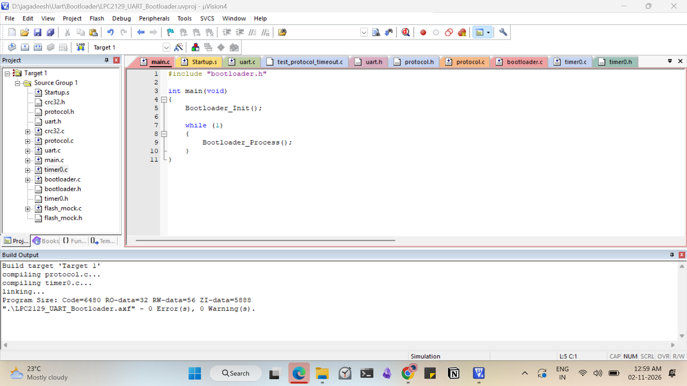
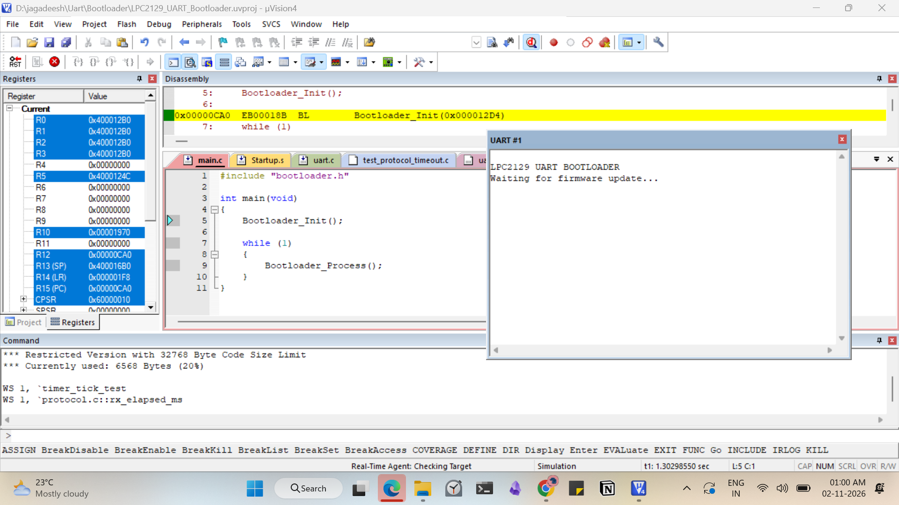
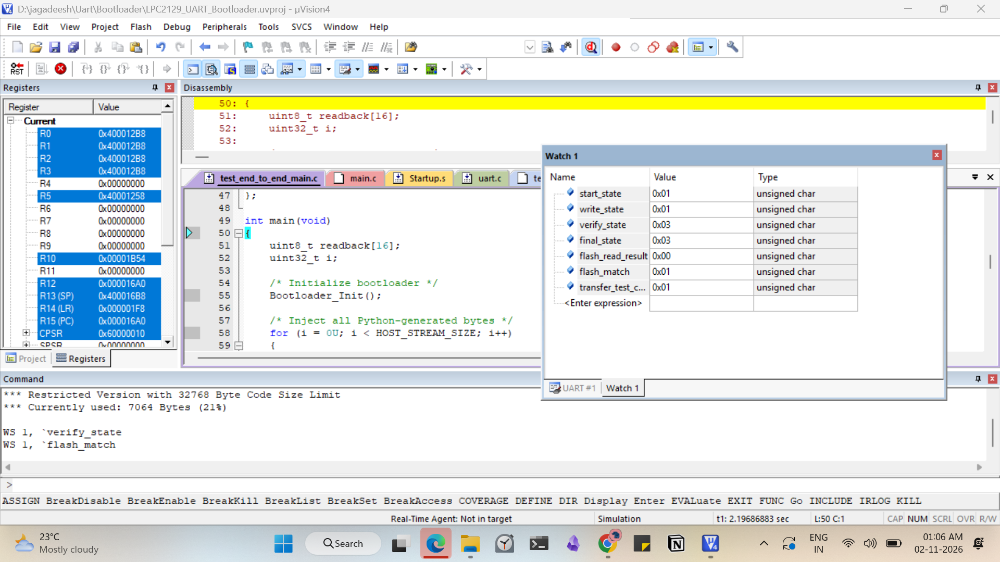

# Testing and Validation Report

## 1. Overview

The UART Bootloader project was tested using Keil µVision simulation and Python host-side test scripts.

The testing process covers individual modules, protocol validation, firmware transfer, error handling and integration.

## 2. Testing Environment

| Component | Environment |
|---|---|
| Target MCU | LPC2129 |
| IDE | Keil µVision4 |
| Embedded Language | C |
| Host Language | Python |
| Communication Interface | UART0 |
| Simulation | Keil µVision |
| CRC Algorithm | IEEE CRC32 |

## 3. Module-Level Testing

| Module | Test Description | Result |
|---|---|---|
| UART | UART initialization and transmission | PASS |
| UART | Non-blocking reception | PASS |
| CRC32 | Standard CRC32 test vector | PASS |
| Protocol | Valid packet parsing | PASS |
| Protocol | Corrupted packet rejection | PASS |
| Protocol | Invalid version rejection | PASS |
| Flash Mock | Sector erase and data write | PASS |
| Flash Mock | Read and verification | PASS |
| Flash Mock | Invalid operation handling | PASS |

## 4. Integration Testing

The embedded bootloader was tested with generated firmware packet streams.

| Test | Description | Result |
|---|---|---|
| Firmware Start | START_UPDATE command | PASS |
| Data Transfer | WRITE_DATA command | PASS |
| Firmware Readback | Flash data comparison | PASS |
| Firmware Verification | Complete image CRC validation | PASS |
| Application Handover | Simulated JUMP_APP command | PASS |
| Duplicate Packet | Exact duplicate detection | PASS |
| Invalid Sequence | Incorrect sequence rejection | PASS |
| Modified Duplicate | Changed duplicate packet rejection | PASS |
| Timeout Recovery | Parser recovery after timeout | PASS |

## 5. Python Host Testing

The following host-side tests were performed:

- CRC32 calculation.
- Packet generation.
- Packet CRC validation.
- Firmware binary loading.
- Firmware chunking.
- Firmware offset validation.
- ACK and NACK parsing.
- Corrupted response rejection.

All listed host-side tests passed.

## 6. End-to-End Test Results

A 76-byte firmware transfer stream was generated using Python and passed to the embedded bootloader test harness through direct byte injection.

Observed results:

| Parameter | Result |
|---|---|
| Stream Size | 76 bytes |
| START_UPDATE | Successful |
| WRITE_DATA | Successful |
| VERIFY | Successful |
| Final Bootloader State | COMPLETE |
| Flash Readback | Successful |
| Firmware Match | TRUE |

## 7. CRC32 Test Vector

Test input:

```text
123456789
```

Expected CRC32:

```text
CBF43926
```

Observed CRC32:

```text
CBF43926
```

Result: PASS

## 8. Keil Build Results

The normal bootloader project compiled successfully.

| Build Parameter | Result |
|---|---:|
| Errors | 0 |
| Warnings | 0 |
| Code Size | 6480 bytes |
| RO Data | 32 bytes |
| RW Data | 56 bytes |
| ZI Data | 5888 bytes |

## 9. Testing Limitations

- Testing was performed using Keil simulation and host-side test scripts.
- No physical LPC2129 hardware testing has been performed.
- The flash implementation is a RAM-based mock.
- Actual flash programming and application handover are not implemented.
- End-to-end byte injection does not prove physical UART communication.

## 10. Conclusion

The implemented bootloader modules passed the documented software tests.

The project demonstrates UART driver development, packet parsing, CRC32 validation, firmware transfer logic, sequence management, duplicate packet handling and error recovery.

Physical hardware validation and actual LPC2129 flash programming remain future development tasks.

## Simulation Evidence

### Successful Keil Build


### UART Bootloader Output


### Firmware Verification


