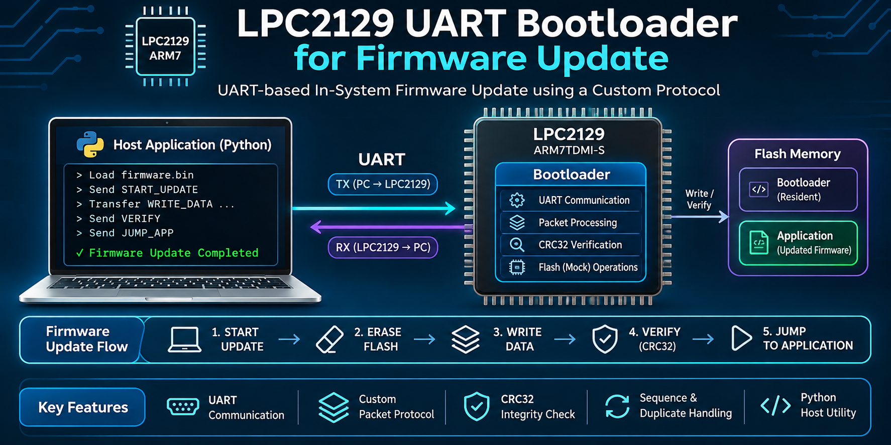
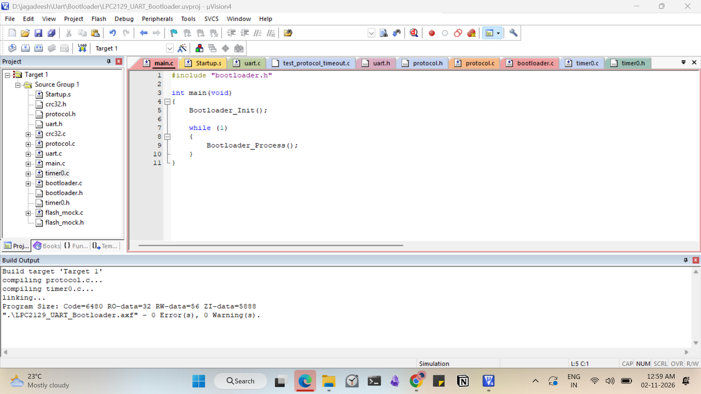
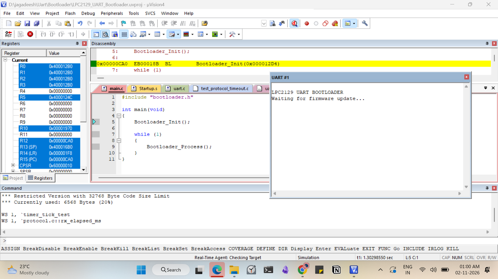
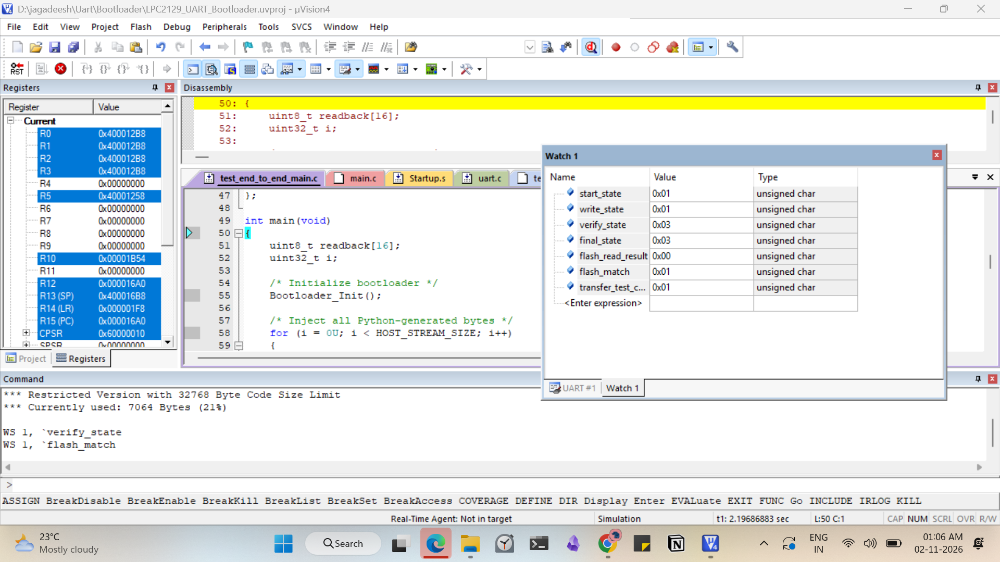

# LPC2129 UART Bootloader for Firmware Update

A UART-based firmware update bootloader developed using Embedded C for the LPC2129 ARM7 microcontroller. This project demonstrates register-level UART communication, custom packet-based firmware transfer, CRC32 integrity verification, sequence management, duplicate packet handling, and firmware validation.

> **Development status:** The bootloader was built and tested using Keil µVision simulation, along with Python host-side tests. Flash operations currently use a RAM-based mock implementation. Physical LPC2129 hardware testing and actual flash programming have not yet been performed.

## Project overview

The system consists of two main sections:

- **Embedded bootloader:** Runs on the LPC2129 target and handles UART communication, packet reception, firmware data validation, simulated flash operations, and update state management.
- **Host application:** Runs on a computer and loads the firmware binary, generates protocol packets, transfers firmware data, and handles ACK/NACK responses.

The host sends firmware in smaller data packets through UART. The bootloader validates each packet before writing its data into simulated flash memory. Once the complete firmware image is received, the bootloader verifies its integrity using CRC32.

## Software and tools required

| Tool / Technology | Purpose |
|---|---|
| LPC2129 | Target microcontroller |
| ARM7TDMI-S | Processor architecture |
| Embedded C | Firmware development |
| Keil µVision4 | Embedded development and simulation |
| Python 3 | Host-side firmware utility |
| UART0 | Serial communication |
| IEEE CRC32 | Firmware integrity verification |
| Git and GitHub | Version control and project hosting |

## Embedded bootloader modules

| File | Purpose |
|---|---|
| `main.c` | Bootloader entry point |
| `bootloader.c` | Firmware update state machine and command handling |
| `uart.c` | Register-level UART0 communication |
| `protocol.c` | Packet creation, parsing, and reception |
| `crc32.c` | CRC32 calculation |
| `flash_mock.c` | RAM-based flash erase, write, read, and verify operations |
| `timer0.c` | Timer0-based receive timeout tracking |
| `Startup.s` | Processor startup and initialization |

## Host application modules

The Python host application prepares and transfers the firmware image.

- **Firmware loading:** Reads the firmware binary.
- **Packet generation:** Creates packets using the custom UART protocol.
- **Data chunking:** Splits firmware into smaller data packets.
- **Serial communication:** Sends packets and receives responses.
- **ACK/NACK handling:** Processes positive and negative acknowledgements.
- **Retry handling:** Supports retry handling for WRITE_DATA transfers.

## UART communication protocol

The bootloader uses a custom packet format to transfer firmware reliably.

### Packet structure

| Field | Size | Description |
|---|---:|---|
| Start of Frame | 2 bytes | Packet synchronization |
| Version | 1 byte | Protocol version |
| Command | 1 byte | Requested operation |
| Sequence Number | 2 bytes | Packet sequence |
| Payload Length | 2 bytes | Payload size |
| Payload | Variable | Command data |
| CRC32 | 4 bytes | Packet integrity value |

**Protocol details**

- Start of Frame: `0xAA 0x55`
- Protocol Version: `0x01`
- Maximum Payload: 256 bytes
- CRC Algorithm: IEEE CRC32
- CRC Polynomial: `0xEDB88320`

### Supported commands

| Command | Value | Description |
|---|---:|---|
| START_UPDATE | `0x01` | Starts firmware update |
| ERASE_FLASH | `0x02` | Defined in the protocol; not independently handled |
| WRITE_DATA | `0x03` | Transfers firmware data |
| VERIFY | `0x04` | Verifies the complete firmware image |
| JUMP_APP | `0x05` | Requests application handover |
| ACK | `0x06` | Positive acknowledgement |
| NACK | `0x07` | Negative acknowledgement |

For the detailed packet layout, refer to [UART Packet Format](Documentation/uart_packet_format.md).

## How the system works

1. The host application loads the firmware binary.
2. The host calculates the expected CRC32 of the complete firmware image.
3. The host sends the START_UPDATE command with firmware size and expected CRC32.
4. The bootloader validates the request and prepares the simulated flash memory.
5. The host divides the firmware into smaller chunks.
6. The host sends WRITE_DATA packets through UART.
7. The bootloader validates packet CRC, sequence number, offset, and memory boundaries.
8. Valid firmware data is written into the RAM-based flash mock.
9. The host sends the VERIFY command after transferring all firmware data.
10. The bootloader checks the received size and complete firmware CRC32.
11. The host sends JUMP_APP after successful verification.
12. The simulator displays a simulated application handover message.

## Error handling

The implementation includes the following checks:

- Invalid Start of Frame detection.
- Unsupported protocol version detection.
- Packet CRC validation.
- Invalid packet length detection.
- Sequence number validation.
- Duplicate WRITE_DATA packet detection.
- Modified duplicate packet rejection.
- Firmware size validation.
- Flash memory boundary checking.
- Invalid flash bit-transition checking.
- Receive timeout recovery.
- ACK/NACK response handling.

## Project setup and execution

### Embedded project using Keil µVision4

1. Open the LPC2129 project in Keil µVision4.
2. Confirm that the LPC2129 target and startup file are configured.
3. Build the project.
4. Start the Keil simulator.
5. Run the bootloader.
6. Open the UART simulator window to observe the bootloader output.

**Build result:** The recorded normal bootloader build completed with 0 errors and 0 warnings.

### Python host application

1. Open the repository in a terminal.
2. Create a Python virtual environment.
3. Activate the environment.
4. Install the dependencies required by the host application.
5. Run the host-side tests.
6. Use the upload utility with a firmware binary and the appropriate serial port when connecting to supported hardware.

Create and activate a virtual environment:

```bash
python3 -m venv .venv
source .venv/bin/activate
```

The host upload flow requires a compatible serial connection and matching target UART configuration. Physical LPC2129 firmware transfer has not yet been validated.

## Testing and validation

The project was tested at module, protocol, host, and integration levels.

Tests performed include:

- UART initialization, transmission, and reception.
- CRC32 calculation and validation.
- Protocol parser tests.
- Valid and corrupted packet tests.
- Flash mock erase, write, read, and verification tests.
- Invalid flash operation tests.
- Python firmware loading and packet generation tests.
- Firmware chunking and offset validation.
- ACK/NACK handling tests.
- Firmware transfer integration tests.
- Duplicate packet and modified duplicate packet tests.
- Protocol timeout recovery tests.

**CRC32 test vector:**

```text
Input:  123456789
Output: CBF43926
```

The embedded protocol and Python host implementation were also tested together using generated packet streams and direct test-byte injection.

This validates the software packet-processing path. It is not a physical UART hardware test.

Refer to [Testing and Validation](Documentation/testing_and_validation.md) for detailed test information.

## Keil µVision simulation

The embedded bootloader was built and tested using the Keil µVision simulator.

### Successful Keil build



### UART bootloader output



### Firmware verification



## Troubleshooting

### 1. UART output is not visible

- Check whether the correct UART simulator window is open.
- Verify UART0 pin selection.
- Check the UART baud-rate configuration.
- Verify the peripheral clock and UART divisor settings.
- Confirm that the bootloader initialization code is executing.

### 2. Packet is rejected

- Check the Start of Frame bytes: `0xAA 0x55`.
- Verify the protocol version.
- Check the payload length.
- Recalculate CRC32 using the IEEE CRC32 algorithm.
- Verify the packet sequence number and firmware offset.

### 3. Firmware verification fails

- Confirm that the host and bootloader use the same firmware image.
- Check whether every firmware data packet was accepted.
- Verify that the received byte count matches the firmware size.
- Confirm that the expected CRC32 was calculated over the complete firmware image.

### 4. Host serial communication fails

- Verify the selected serial port.
- Check the USB-to-UART adapter connection.
- Confirm TX and RX connections.
- Ensure both sides use compatible logic voltage levels.
- Verify that the host baud rate matches the target UART configuration.

## Practical notes and limitations

- Flash operations currently use a RAM-based mock instead of LPC2129 internal flash.
- The mock flash is limited to 4 KB and is not persistent after reset.
- Receive timeout tracking uses a polling-based Timer0 flag.
- The protocol parser has basic frame recovery and can be improved for stronger resynchronization.
- Duplicate WRITE_DATA detection uses packet length and CRC rather than a full-payload comparison.
- JUMP_APP is simulated; an actual application jump is not performed.
- No physical LPC2129 board testing has been performed.

## Future improvements

- Implement actual LPC2129 internal flash erase and programming routines.
- Test firmware updates using a physical LPC2129 development board.
- Implement a real application handover mechanism.
- Improve packet timeout and resynchronization handling.
- Strengthen duplicate packet verification.
- Add bootloader memory protection and application image boundary checks.
- Validate UART communication using a USB-to-TTL adapter.
- Perform complete hardware-level firmware update testing.

## Resume description

**LPC2129 UART Bootloader for Firmware Update**

Developed a UART-based firmware update bootloader for the LPC2129 ARM7 microcontroller using Embedded C. Implemented register-level UART0 communication, a custom packet protocol, CRC32 integrity verification, sequence management, duplicate packet handling, and a Python-based host utility. Built and validated the software using Keil µVision simulation and host-side integration tests, with flash operations represented by a RAM-based mock.

## One-line project summary

Developed an LPC2129 UART bootloader prototype with packet-based firmware transfer, CRC32 validation, sequence control, and Python host-side communication.

## Repository structure

```text
UART-Bootloader-Firmware-Update/
├── Bootloader/
├── Host/
├── Application/
├── Documentation/
│   ├── Screenshots/
│   ├── architecture.md
│   ├── firmware_update_sequence.md
│   ├── uart_packet_format.md
│   └── testing_and_validation.md
├── Tests/
├── README.md
└── .gitignore
```

## Project documentation

- [System Architecture](Documentation/architecture.md)
- [Firmware Update Sequence](Documentation/firmware_update_sequence.md)
- [UART Packet Format](Documentation/uart_packet_format.md)
- [Testing and Validation](Documentation/testing_and_validation.md)

## Author

**Jagadeesh**

GitHub: [jagadeeshsys](https://github.com/jagadeeshsys)

Project Repository: [UART-Bootloader-Firmware-Update](https://github.com/jagadeeshsys/UART-Bootloader-Firmware-Update)
